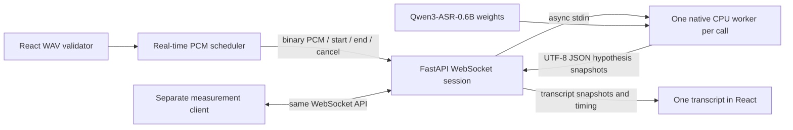

# Tetherfi — CPU multilingual streaming ASR

A local engineering prototype for the four-day Tetherfi assignment. React/TypeScript streams WAV audio over WebSocket to FastAPI. Each call receives a separate native `antirez/qwen-asr` process running Qwen3-ASR-0.6B with the macOS Accelerate CPU build. The UI displays one transcript that can revise recent words as new audio provides context. A small version-controlled patch makes the native runtime emit complete UTF-8 hypothesis snapshots over stdout; the final snapshot is the completed transcript.

## Setup

Prerequisites: Apple Silicon macOS, Xcode command-line tools (`xcode-select --install` if absent), Python 3.11+, Node 20.19+ or 22.12+, npm, Git and curl. This workspace was developed with Python 3.14.6 and Node 24.20.0 on an M2 MacBook Air with 8 GB RAM. Linux requires OpenBLAS development packages; Linux has not been tested.

From this project directory:

```sh
bash scripts/setup.sh
```

Setup creates `.venv`, builds the pinned native runtime, downloads about 1.88 GB of official model weights into `.runtime/models`, verifies the weights' SHA-256, and installs frontend dependencies. Allow several GB of free disk space and time for the download. No GPU backend is built. Model weights/runtime builds/dependencies are ignored by Git.

Run in two terminals:

```sh
source .venv/bin/activate
uvicorn backend.app:app --host 127.0.0.1 --port 8000 --ws-max-size 32768 --ws-max-queue 4
```

```sh
cd frontend
npm run dev
```

Open http://127.0.0.1:5173. Choose a **16 kHz, mono, uncompressed PCM16 WAV**, select a language or auto detect, then Start streaming. The recording plays aloud in the browser while its PCM chunks are sent at real-time pace. Turn on your speakers and keep the tab active. Stop ends playback and cancels the worker and preserves the text already displayed. Maximum input duration is five minutes. No microphone, accounts, database, cloud service or translation is included.

To prepare an audio file (requires separately installed FFmpeg):

```sh
ffmpeg -i original.wav -ac 1 -ar 16000 -c:a pcm_s16le prepared.wav
```

Ready-to-select FLEURS test recordings are bundled in `samples/` for Mandarin and Indonesian. Their reference text, original filename, test split and CC BY 4.0 provenance are in adjacent JSON files. The English upstream sample is available after setup at `.runtime/qwen-asr/samples/jfk.wav`. Upstream also includes longer English samples and reference text. These smoke recordings are not the planned FLEURS multilingual evaluation set.

## Verification

```sh
.venv/bin/python -m pytest -q
(cd frontend && npm test && npm run build)
.venv/bin/python scripts/verify_runtime.py \
  --binary .runtime/qwen-asr/qwen_asr \
  --model .runtime/models/qwen3-asr-0.6b \
  --wav .runtime/qwen-asr/samples/jfk.wav \
  --output evidence/runtime-local.json
.venv/bin/python scripts/stream_client.py \
  .runtime/qwen-asr/samples/jfk.wav --language en \
  --output evidence/websocket-local.json --require-incremental
```

The direct runtime check uses the legacy committed-token output unless test flags are supplied. It feeds raw PCM in 500 ms intervals, reads stdout concurrently, closes stdin at the audio end, and records whether nonblank output arrived **before EOF**. It exits unsuccessfully if incremental recognition was not demonstrated, even if a final transcript was returned. Short clips may finish before the native stabilization logic emits text; use a longer sample when investigating. WebSocket verification requires the backend running.

`tests/fake_runtime.py` is a subprocess fixture for protocol/error tests, not a speech model. Those tests cannot establish speech accuracy or real-model performance. See `evidence/` and `docs/status.md` for executed checks and limitations. A single 15 s English CPU trial passed direct incremental stdin/stdout and end-to-end WebSocket checks; see the status file for measured timings. No benchmark numbers should be inferred from passing fixture tests.

## Architecture



The native engine owns context caching, rollback and stable emission. The tracked `runtime_patches/early-commit.patch` adds `--hypotheses`: one JSON line per native inference step containing its complete current text (committed prefix plus revisable tail). The backend replaces its transcript with each snapshot; React displays that same single transcript. Some recently shown words may change. The backend does not invent overlapping windows or run offline transcription after upload. `--stdin --stream --hypotheses` is required. Stderr is independently drained into a bounded diagnostic tail. The legacy committed-token path remains available with `ASR_HYPOTHESES=0`.

Network chunks default to 500 ms (16,000 bytes). The UI and test client also support 250/1000 ms for later comparisons. The default native inference step remains 2 s with an 8 s encoder window, 5-token rollback and two holdback windows for committed text. Hypothesis snapshots can appear before commitment and be revised. The 1 s/zero-holdback experimental mode caused major Indonesian and Mandarin errors; 0.5 s also duplicated English words. See `docs/latency-experiment-2026-11-12.md`.

Session state, processes and transcripts are isolated. A bounded audio queue, pipe drain timeout, idle-input timeout, finalization timeout, duration limit and real-time pacing check bound common failure cases. Cancellation/disconnect terminates and reaps the child. One inference slot is allowed by default on this 8 GB machine; this is a conservative admission setting, **not a measured capacity limit**.

## Configuration and limits

Set environment variables before starting the backend:

| Variable | Default | Purpose |
|---|---|---|
| `ASR_BINARY` | `.runtime/qwen-asr/qwen_asr` under project | Native CPU binary |
| `ASR_MODEL` | `.runtime/models/qwen3-asr-0.6b` under project | Local model directory |
| `ASR_THREADS` | 4 | Native worker thread setting |
| `ASR_MAX_SESSIONS` | 1 | Admission limit; increase only for controlled tests |
| `ASR_HYPOTHESES` | 1 | Emit revisable single-transcript snapshots; 0 uses legacy committed tokens |
| `ASR_STREAM_STEP_SEC` | 2.0 | Native inference step; keep default unless experimenting |
| `ASR_UNFIXED_CHUNKS` | 2 | Native committed-text holdback; keep default unless experimenting |

Use a single Uvicorn process. Multiple server workers would each have their own admission limit. This is a local prototype, not a public authenticated service. Browser origins are restricted to localhost/127.0.0.1 on ports 5173/8000. Vite proxies the WebSocket endpoint to the backend. A production frontend build is provided, but production hosting is not configured.

The application queue metric only measures bytes waiting to be written to native stdin. The runtime has its own audio buffers; successful writes do not prove inference has kept up. Native inference backlog instrumentation and sustained-load measurements remain future work. The five-minute cap also bounds that exposure.

## Timing definitions

- `first_text_ms`: server monotonic time from first audio received to first nonblank text. Model loading can overlap this interval. It excludes browser file selection and connection setup.
- `final_latency_ms`: server monotonic time from receiving `end` to completion. Displayed as final only on `done`.
- `elapsed_ms`: time from accepted/reserved session to the event.
- `audio_received_seconds`, `audio_forwarded_seconds`: PCM byte counts divided by 32,000.
- `application_queue_seconds`: received minus forwarded audio duration, **not inference backlog**.

Full-paced wall time/audio duration is not inference RTF. Cold and warm conditions must be stated when reporting latency. RSS sampling is approximate and includes memory-mapped pages.

## Troubleshooting

- Worker failure: inspect backend logs; check the model download completed and the CPU binary exists. Partial weight downloads are never installed as final files.
- No early text: inspect the native step, CPU processing and recorded event times. Hypotheses are revisable, so an early guess is not guaranteed correct.
- Capacity error: wait for the active stream to finish. Test concurrency deliberately, with memory monitoring.
- Invalid WAV: convert with the command above. Compressed/float/stereo WAV and malformed RIFF sizes are rejected.
- Tab scheduling/network error: keep the tab active and restart. The sender refuses a large catch-up burst after a long pause.
- Silence/empty recognition: a successfully completed stream may have no speech. Accuracy needs reference audio and scoring, not merely a successful exit code.

## Provenance and next steps

Runtime: https://github.com/antirez/qwen-asr at `924694251d9e0f18e5d86bbd06aa3ab5f870002d` (MIT). Model: https://huggingface.co/Qwen/Qwen3-ASR-0.6B at `5eb144179a02acc5e5ba31e748d22b0cf3e303b0` (Apache-2.0). Weights SHA-256: `79d6cbd4c98c7bbffe9db2edac07f56cd6637d0d5944b27f6c2b8353840323ea`. The native runtime is a community C implementation; it is not C++ or the official Python runtime. `scripts/setup.sh` applies our tracked hypothesis-output patch to that pinned runtime before building.

To verify CPU execution while streaming on macOS, open **Activity Monitor → CPU** (Command-Space, then type Activity Monitor) and search for `qwen_asr`. Its `% CPU` should rise during transcription; the per-call process exits at completion. `otool -L .runtime/qwen-asr/qwen_asr` shows the Accelerate framework in the linked CPU binary. This build does not enable Metal, CUDA or ROCm inference.

One local English, Mandarin and Indonesian recording each has now completed through the native CPU WebSocket path with incremental text. This demonstrates the three language paths but is not a corpus accuracy benchmark. See `docs/status.md`.

The prior Architecture V2 and the original five-page assignment were inspected before implementation. See `docs/protocol.md` for API messages and `docs/benchmark-plan.md` for Days 2–4, multilingual data, chunk comparison, concurrency, sizing, alternative ASR and remaining submission requirements.
